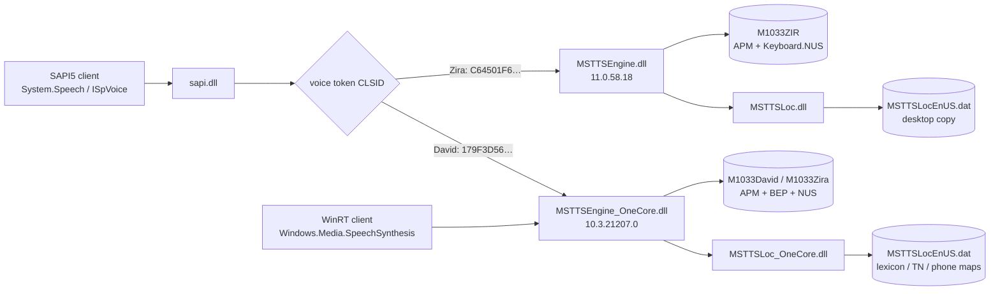
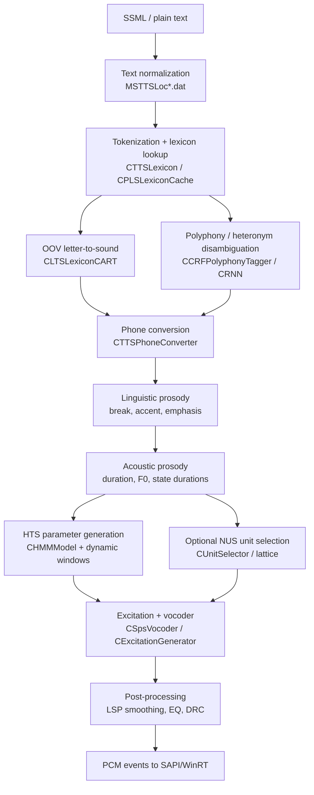

# Microsoft David / Zira (Windows MSTTS 11/10.3) — architecture dossier

Status: static reverse engineering + runtime probes. Reimplementation is **not**
provided (architecture-only, per project decision). Every binary claim below is
tied to a SHA-256 in `artifacts/inventory.json`; decompiled evidence is indexed in
`docs/ghidra-index.md`.

## 1. Scope and host

| Item | Value |
|---|---|
| Host OS | Windows 10.0.26200 (x64) |
| SAPI voices | `TTS_MS_EN-US_DAVID_11.0`, `TTS_MS_EN-US_ZIRA_11.0` |
| OneCore voices | `MSTTS_V110_enUS_DavidM`, `MSTTS_V110_enUS_ZiraM` (also Mark/Sabina/Raul) |
| Analysis | Ghidra 12.2 PUBLIC + Microsoft public PDBs, Python 3.14, pefile, capstone |

The same product name maps to **two different engine generations**. This is the
single most important fact for a reimplementation: "David" under SAPI and "David"
under WinRT are not guaranteed to be bit-identical, and "Zira" under SAPI uses a
different engine and data set than "Zira" under WinRT.

## 2. Runtime topology



Evidence:
- CLSID → DLL mapping: `artifacts/registry.json`; token exports are in
  `artifacts/registry.json` under `SOFTWARE\Microsoft\Speech[_OneCore]\Voices`.
- In-process module probe (`scripts/module_probe.ps1`): SAPI David loads only
  `MSTTSEngine_OneCore.dll` + `MSTTSLoc_OneCore.dll`. SAPI Zira loads both engine
  pairs; its token CLSID is the Desktop engine, and its audio differs from WinRT
  Zira (different data set), so the Desktop path is the effective renderer.
- WinRT enumerates the `Speech_OneCore\Voices\Tokens` keys only.

### 2.1 Same text, different render paths

`"The quick brown fox jumps over the lazy dog."`, 16 kHz mono:

| Path | Duration | PCM RMS | Relationship |
|---|---:|---:|---|
| SAPI David | 3.375 s | 724,698 | — |
| WinRT David | 3.375 s | 721,271 | corr 0.9498, gain 0.9953 |
| SAPI Zira | 3.330 s | — | differs from WinRT Zira |
| WinRT Zira | 3.430 s | — | different length/PCM |

SAPI David and WinRT David are the same engine/data with API-level prosody
differences (0.95 correlation). Zira is not: the Desktop and OneCore Zira data
sets are different models. This is why the archive stores all four paths.

## 3. Binaries and PDBs

| Binary | Version | Size | SHA-256 (prefix) | PDB |
|---|---|---|---|---|
| `MSTTSEngine_OneCore.dll` | 10.3.21207.0 | 1,953,792 | `557bab54…` | `MSTTSEngine_OneCore.pdb` |
| `MSTTSLoc_OneCore.dll` | 10.3.21207.0 | 757,760 | `df438c74…` | `MSTTSLoc_OneCore.pdb` |
| `MSTTSEngine.dll` | 11.0.58.18 | 1,045,888 | `28666e36…` | `MSTTSEngine.pdb` |
| `MSTTSLoc.dll` | 11.0.58.18 | 557,056 | `e7d021bb…` | `MSTTSLoc.pdb` |
| `sapi.dll` | 5.3.32117.0 | 1,515,520 | `a62010e1…` | `sapi.pdb` |
| `Windows.Media.Speech.dll` | 10.0.26100.9278 | 1,592,376 | `6d3c8315…` | `Windows.Media.Speech.pdb` |

Microsoft's public symbol server served all four MSTTS PDBs. Ghidra imports the
PDBs from `artifacts/bin/` and resolves the C++ symbols; the public symbols do not
include source/local-variable names.

### 3.1 Engine generations

| Feature | OneCore engine 10.3 | Desktop engine 11.0.58.18 |
|---|---|---|
| Functions (Ghidra) | 6,851 | 3,703 |
| HTS HMM | yes | yes |
| DNN classes | `CDNNAcousticModel`, `CDNNVoiceData`, `CMLPDNNLayer` | none |
| NUS / unit selection | yes | yes |
| Opus/SILK/CELP inventories | yes | no (RTTI) |
| Vocoder class | `CSpsVocoder` | `CVocoder` + `CExcitationGeneratorImpl` |
| TFTE excitation | `CITFTEExcitationGeneratorImpl` | none found |
| Locale analyzers | many languages in `MSTTSLoc_OneCore.dll` | desktop locales |

The Desktop engine is not a stripped OneCore build; it is a separate 11.x
code line with the older vocoder/inventory surface. The shared concepts are the
HTS decision trees, `CHMM*` model/state/stream objects, NUS unit selection, and
the LSF synthesis core.

## 4. Voice data sets

### 4.1 OneCore en-US (`C:\Windows\Speech_OneCore\Engines\TTS\en-US`)

| Voice | APM | BEP | INI | Extra |
|---|---:|---:|---:|---|
| David | 7,939,268 | 1,776 | 912 | `NUSData\M1033David.keyboard.{NU2,RAD,UNT,WIH,WVE}` |
| Zira | 2,406,610 | 1,776 | 1,359 | `M1033Zira.SPEECHUX.NUS` 1,389,270; `M1033Zira.TBT.NUS` 1,988,482; keyboard set |
| Mark | 1,967,740 | 1,776 | 1,234 | speechux/tbt/keyboard sets |
| (Eva) | 378,236 | 8,296 | 1,645 | `.ACL .BR2 .HEQ .NNM .TDAT .TON` prosody models; not registered |

### 4.2 Desktop en-US (`C:\Windows\Speech\Engines\TTS\en-US`)

| Voice | APM | BEP | INI | Extra |
|---|---:|---:|---:|---|
| Zira | 6,182,080 | — | 494 | `M1033ZIR.Keyboard.NUS` 17,395; shared `MSTTSLocEnUS.dat` 9,258,072 |

The Desktop Zira data is the older, HMM-only shape: no BEP, no speechux/tbt NUS,
only a keyboard unit inventory. OneCore David/Zira carry BEP and (for Zira/Mark)
domain unit inventories.

## 5. Data formats

All multi-byte integers are little-endian.

### 5.1 `.APM` — acoustic parameter model

Proven by `CHTSVoiceData::LoadHTSFontSectionHeader` / `LoadVoiceDataHeader` /
`LoadData` / `ValidateFileHeader` and `CTTSDataLoader::LoadFontSectionHeader`.

```
wrapper (0x18 bytes)
0x00  char[4]  "APM "
0x04  u64      0x4A9B42036B708576          (fixed signature)
0x0c  u64      0xD0ADA452F8FF1D9B          (fixed signature)
0x14  u32      payload_size = file_size - 0x18
0x18  HTS_VOICE_DATA_HEADER (0x40 bytes)
```

`HTS_VOICE_DATA_HEADER` (payload offsets; add 0x18 for file offsets):

| Off | Type | Field | Zira value | David value |
|---:|---|---|---:|---:|
| 0x00 | u32 | format version | 3 | 3 |
| 0x04 | u32 | checksum | 0x2BC7064F | 0x28AB0801 |
| 0x08 | u16 | LCID | 0x0409 | 0x0409 |
| 0x0a | u16 | model revision | 1 | 0 |
| 0x0c | u32 | flags | 1 | 0 |
| 0x10 | u32 | sample rate | 16000 | 16000 |
| 0x14 | u32 | sample width | 16 | 16 |
| 0x18 | u32 | frame shift (samples) | 80 | 80 |
| 0x1c | u32 | question-definition offset | 0x58 | 0x58 |
| 0x20 | u32 | question-definition size | 0x4AC8 | 0x59E4 |
| 0x24 | u32 | acoustic-model offset | 0x4B20 | 0x5A3C |
| 0x28 | u32 | acoustic-model size | 0x2460F4 | 0x77B3E0 |
| 0x2c | u32 | compressed-PDF offset | 0x24AC14 | 0x780E1C |
| 0x30 | u32 | compressed-PDF size | 0x0CBE (3262) | 0x116A8 (71336) |
| 0x34 | u32 | extension offset | 0 | 0 |
| 0x38 | u32 | extension size | 0 | 0 |
| 0x3c | u32 | reserved | 0 | 0 |

`LoadData` then performs, in order:

```
CForestQuestionSet::LoadData(qset,
    base + hdr[0x2c], hdr[0x30],     // 0x24AC14, 0x0CBE
    base + hdr[0x1c], hdr[0x20]);    // 0x58,     0x4AC8
LoadAcousticModels(base + hdr[0x24], hdr[0x28]); // 0x4B20, 0x2460F4
```

So the body is:

| Range (Zira) | Size | Meaning |
|---|---:|---|
| 0x58 .. 0x4B20 | 19,144 | question/feature definitions |
| 0x4B20 .. 0x24AC14 | 2,384,116 | acoustic model set (header + trees + float parameter block) |
| 0x2460F4 .. 0x24AC14 | 19,232 | `float32` mean/variance/gain triples inside the model set |
| 0x24AC14 .. 0x24B8D2 | 3,262 | Huffman/compressed PDF payload |

The model-set head is voice-dependent: Zira `05 00 00 00 2C 00 00 00` = 5 streams,
44 states; David and Desktop Zira begin `04 00 00 00 24 00 00 00` = 4 streams,
36 states. The float
block begins `0x3F09C050, 0x3C512862, 0x3F800000` = `(0.5376, 0.0127, 1.0)`.
The first triples for Zira are `(0.5376,0.0127,1.0)`, `(0.6382,0.0296,1.0)`,
`(0.7400,0.0302,1.0)` — the classic HTS mean/variance/constant shape.

`LoadDecisionTrees` reads two u32 counts, allocates `CHTSDecisionTreeSet[count]`
(0x28 bytes each), and decompresses the tree payload with
`CHTSVoiceData::CreateDecompressor` when the first count word is non-zero.
`BuildDuration` and `BuildHMMState` then turn decision-tree leaves into
`CHMMStream`/`CHMMGaussMixture` objects.

### 5.2 `.BEP` — runtime parameter table

`CTTSEngine::InitializeEngineSetting` builds `<VoicePath>.INI` and
`<VoicePath>.BEP`, then loads the BEP with
`CTTSSharedDataLoader::LoadSharedData<CParameterManager>`. It is **not** a
vocoder excitation file; it is a named runtime-parameter table.

`CParameterManager::LoadData` (`0x180113dc0`) parses:

```
0x00  u32 magic          0x54504542 ("BEPT")
0x04  GUID               30 af d7 ec a2 39 c2 4f a4 b9 ee 9d 44 02 3a 6f
0x14  ...                extended-header fields
0x1c  u64 payload_size   file_size - 0x24
0x24  u32 count          18
0x28  {u32 id; i32 offset; i32 size}[count]   (12 bytes each)
...   parameter blobs; each offset is relative to the end of the record array
```

IDs observed in the shipped files: `2,3,4,5,6,7,8,9,11,12,13,14,15,16,17,18,30,31`.
Blobs are 4, 12, or 148 bytes. `Query(RUNTIME_PARAMETER, &ptr, &size)` is a
linear scan over `{id, ptr, size}` entries (`0x18007abac`).

### 5.3 `.NUS` / `.NU2` — unit-selection inventory

`CNUSVoiceDataLoader::LoadData` uses
`CTTSDataLoader::LoadFontSectionHeaderEx` with GUID
`06578A8B-CE75-3B48-964D-F7C21873DF8F`. After the 0x24-byte extended header:

| Off | Type | Meaning |
|---:|---|---|
| 0x00 | u32 | feature-name count |
| 0x04 | u32 | unit/entry count |
| 0x08 | u32 | encrypted string-table offset |
| 0x0c | u32 | string-table byte length (even) |
| 0x10 | 12-byte records | feature metadata (`CTTSFeatureMeta::Parse`) |

The string table is UTF-16LE and decrypted with
`CStringEncryption::EncryptByMask`. `LoadUnit` then reads a 32-bit unit count,
8-byte unit descriptors, and per-unit `TTS_FEATURE_VALUE` arrays. Unit payloads
are decoded by the Opus/SILK/CELP classes in RTTI
(`COpusSILKEncodedAcousticData`, `CSILKEncodedAcousticData`,
`CCELPCodedInventory`, `CCELPEncodedSpeechDataVBR`). `.NU2` is the domain variant
under `NUSData\` (`*.keyboard.NU2`).

`.NUS` is optional for normal text: David has no speechux/tbt NUS and still
speaks. The INI declares when a domain switches to NUS (`NusData1=TBT.NUS`,
`NusData2=SpeechUX.NUS`, `NusData3=keyboard.NU2`).

### 5.4 `.DAT` (locale handler)

`CTTSDataBase::LoadDataObjects` (`0x1800725b0`) parses a recursive object graph:

```
record (0x28-byte header + payload, padded to 8 bytes)
0x00  GUID  object id
0x10  GUID  object type/schema (often zero)
0x20  u64   payload size
0x28  bytes payload
```

`CTTSDataBase::GetDataObject` (`0x180072508`) looks up a record by GUID.
Outer objects are containers whose payload is another object table; the shipped
`MSTTSLocEnUS.dat` is such a container, with leaves for lexicons, CART models and
phone data. `CTTSFeatureCARTData::LoadData` and `CTrieLexicon::Load` parse the
leaf formats (3-byte magic + 16-byte signature + arrays for CART; trie blob +
offset/value arrays for lexicons).

The companion `.INI` is UTF-16LE and lists the six TN domains (`address`, `name`,
`message`, `computer`, `media`, `companyName`), `[TN]` and `[SayAsMapping]`.
`MSTTSLoc*.dll` exports only `GetLocaleHandler`; the engine owns the `.dat` and
passes objects to the locale handler through `IMSTTSEngine` interfaces.

## 6. Engine pipeline

The stage order below is taken from decompiled call sites, not from class names
alone. Key calls:

1. `CEngineAdapterSAPI::Speak` (`0x1800637d0`) converts `SPVTEXTFRAG` to
   `TTSTEXTFRAGMENT` and calls the engine's `LocalSpeak`.
2. `CTTSEngine::LocalSpeak` (`0x180028288`) resolves the voice/domain/emotion,
   calls `PrepareForSpeaking` (`0x180094904`), then for each utterance either
   runs `ProcessParallelPipelines` (`0x180094a2c`) or the serial handler list.
3. `CTextProcessor::DoProcess` (`0x18005c794`) runs `ParseSentence`
   (`0x180063378`), which invokes `CSentenceAnalyzer::Analyze` and phone-list
   construction, then the regularizer/quotation/parallel-structure detectors.
4. Backend handlers are spawned one thread per entry in the engine's handler
   array (`this+0x1c8`, count `this+0x1d0`) and synchronized on the utterance's
   condition variable. The linguistic prosody tagger runs before the acoustic
   prosody tagger; both write into the shared `CTTSUtterance`.
5. `CAcousticProsodyTagger::Process` -> `DoProcess` -> `BuildModels` + `Predict`.
   `Predict` drives `CDurationPredictor::Predict` (`0x1800692d0`),
   `CF0Predictor::Predict` (`0x1800a615c`), and the HTS parameter generation.
6. `CSpsVocoder::Synthesize` (`0x180009b14`) consumes the predicted
   LSF/F0/gain/MBE matrices, generates excitation, runs LSF synthesis, and
   concatenates waveform segments.
7. `CWaveGenerator` (`0x1800321f0`, `0x18006d71c`) emits PCM chunks; `CTTSOutput`
   writes SAPI/WinRT events.

The RTTI class inventory agrees with the stage decomposition:



### 6.1 Text analysis

- `MSTTSLoc*.dll!GetLocaleHandler` is the only export. It builds the locale
  handler used for TN, lexicons and phone conversion.
- Runtime keys: `Engine.LangDataPath`, `Engine.VoiceDataPath`,
  `HKEY_LOCAL_MACHINE\SOFTWARE\Microsoft\Speech_OneCore\TextNormalizers`,
  `...\PhoneConverters`, `FrontendBackendPhoneConverter_%s`,
  `UPSSAPIPhoneConverter_Backend_%s`.
- `CLTSLexiconCART` handles out-of-vocabulary words; `CCRFPolyphonyTagger`,
  `CRNNModelData`, `CPolyphonyHandler` handle heteronyms/acronyms.
- `.INI` `[TN]` sets `TNScope=FullContext`, punctuation boundaries and decimal /
  thousand separators.

### 6.2 Prosody

Predictors/classes observed in RTTI:
`CProsodyModelRunner`, `CDurationPredictor`, `CF0Predictor`,
`CProsodyBreakPredictor`, `CProsodyPitchAccentPredictor`,
`CProsodyEmphasisPredictor`, `CProsodyBoundaryTonePredictor`,
`CLinguisticProsodyTagger`, `CAcousticProsodyTagger`,
`CAcousticProsodyTaggerAnchor`, `CProsodyModelRunner`.

`ProsodyModelSetting.*` names the optional per-voice prosody files
(`.ACL .ACT .B23 .BR0 .BR2 .BR3 .BRK .CBD .EMC .EMP .TON`). Eva ships these files;
David/Zira do not, so their prosody is predicted by the shared models in the
locale data plus the HTS model.

### 6.3 Acoustic model

`CHTSAcousticModel` / `CHTSVoiceData` / `CHTSModelSetManager` implement the HMM
path. Decision-tree leaf types are explicit:
`CHTSF0LeafNode`, `CHTSLSFLeafNode`, `CHTSMBELeafNode`, `CHTSOffsetLeafNode`,
`CHTSPhoneDurationLeafNode`, `CHTSStateDurationLeafNode`, `CUnitCandidateLeafNode`.
`CHMMModel`, `CHMMState`, `CHMMStream`, `CHMMGaussMixture`,
`CHMMDynamicWindow(Set)` generate state sequences and dynamic features (MLPG-style
parameter generation).

`CDNNAcousticModel`, `CDNNVoiceData`, `CMLPDNNLayer`, `CDNNModelSetManager` are
also linked into the OneCore engine. No installed David/Zira/Mark model carries a
DNN payload signature, so these voices use the HTS path. `[INFERENCE: the APM
header/layout matches HTS; no DNN-specific file is present for these voices.]`

### 6.4 Unit selection (NUS)

`CNUSVoiceDataLoader`, `CNUSVoiceData`, `CTemplateNUSVoiceData`,
`CNusLatticeProcessor`, `CNusTrajectoryRefiner`, `CUnitSelector`,
`CNusUnitDetectorManager`, `CPitchTargetCostFilter`.
Runtime knobs: `NusRuntime.*` (candidate score, long-unit overlap, transition
length, trajectory-refinement weight/window), `Pipeline.UnitSelectorThreadNumber`,
`Pipeline.LatticeGeneratorThreadNumber`.

NUS is domain-scoped. The INI lists `keyboard`, `tbtdirection`, `speechux`; a NUS
domain replaces the HMM realization for that domain while sharing the front-end.

### 6.5 Vocoder and output

OneCore `CSpsVocoder::Synthesize<float>` (`0x180009b14`) and
`Synthesize<int>` (`0x180074968`) do the following:

1. Bind five parameter matrices from the utterance (`this+0x48`, `+0x50`,
   `+0x58`, `+0x60`, and the LSF matrix) — LSF, F0, gain, MBE/excitation and
   auxiliary features.
2. If `this+0x10c == 0`, call `CExcitationGeneratorImpl<float/int>::GenerateExcitation`;
   otherwise call `CITFTEExcitationGeneratorImpl<float>::GenerateExcitation`
   (`0x18010e208`), which in turn calls `CITFTE::SynthesisTFTE`,
   `SynthesisTimeDomainLPC`, and `SynthesisTimeDomainTFTE`.
3. Call `CLsfSynthesizerImpl<float,float>::Synthesize` (`0x18006b620`), which
   calls `GenerateLpc`, `GetExponentGain`, and `EnlargeLpcUnitCircle` to produce
   the LPC/spectral waveform.
4. Call `DoWaveConcatenation<float/int>` and `CSpsVocoder::ProcessSoundEffect`.

The Desktop `CVocoder::Process` (`0x18004dfd0`) is the older equivalent: it reads
the `CTTSAcousticSpace`, allocates the output buffer from the maximum unit
duration, and calls `Synthesize<float>` or `Synthesize<int>` based on
`this+0x6c`. There is no TFTE branch.

Supporting classes/keys:

- `CExcitationGenerator(Impl<int|float>)`, `CMBEPredictor`.
- `CCodecLspSmoother`, `CWaveSmoother`, `WaveGeneration.LspSmooth`,
  `WaveLoader.AlwaysSmooth`.
- `LSPDecomposing.*`, `[LsfSharpen]`, `[BiquadFilterSetting]`, `[DrcSetting]`
  control spectral sharpening, equalization and dynamic-range compression.
- `CTTSBAWaveFile`, `CWaveLoader`, `CWaveMetaInfo`, `CWaveSegmentMeta` handle
  wave inventories and output chunking.

The model rate is 16 kHz; the engine resamples to the requested output format.
SAPI output in this capture was 16 kHz/16-bit/mono when explicitly set.

## 7. Voice-specific differences

| Property | David (OneCore) | Zira (OneCore) | Zira (Desktop) |
|---|---|---|---|
| APM size | 7.9 MB | 2.4 MB | 6.18 MB |
| BEP | yes | yes | no |
| speechux NUS | no | yes | no |
| tbt NUS | no | yes | no |
| keyboard NUS | yes (`NU2`+WVE) | yes (`NU2`+WVE) | yes (`Keyboard.NUS`) |
| env/emotion recipe | default | happy/sad/angry | happy/sad/angry |
| rate normal factor | 81 | 63 | (not set; default) |
| short pause | disabled | enabled | disabled |
| sample rate | 16000 | 16000 | 16000 |

Desktop Zira's INI is minimal (no `[Domain] Number`, only `NusData0=KEYBOARD.NUS`),
matching an older engine build. David's OneCore INI has `[Domain] Number=1` and a
keyboard domain; Zira's has four domains.

## 8. Reimplementation assessment

Architecture-only is the correct outcome. The front-end (TN, lexicon, LTS,
polyphony) and the back-end (HTS decision trees, MLPG, excitation, vocoder) are
each substantial, and the voice identity is encoded in the trained APM/BEP/NUS
parameters, not in the code. A from-scratch reimplementation would need:

1. parsers for APM/BEP/NUS/DAT (formats above; BEP is a `CParameterManager`
   table, not an excitation model);
2. a compatible HTS parameter generator (decision-tree traversal over the
   voice-dependent model set, 4–5 streams and 36–44 states, with dynamic windows);
3. a 16 kHz LSP/MBE vocoder with pitch-mark excitation matching `CSpsVocoder`;
4. the locale lexicon/TN/phone-conversion data, or an equivalent front-end;
5. bit-exact handling of the INI EQ/DRC/smoothing settings.

None of these can be validated against a reimplementation today. The archive
therefore serves as the golden corpus: any future implementation can be scored
with `scripts/verify_parity.py` (byte-exact) or `--pcm-only`.

## 9. Verification performed

- Read registry tokens and CLSIDs; resolved both engine DLLs.
- Downloaded and applied public PDBs; Ghidra analysis and decompilation.
- Rendered 176 reference WAVs across SAPI and WinRT; all 176 match the manifest
  (100.000%).
- Determinism: three independent SAPI renders per voice were byte-identical.
- Module probe confirms which engine DLL each SAPI voice loads.

## 10. Open questions

- Mapping of BEP `RUNTIME_PARAMETER` IDs to names/units.
- APM section A: which tree uses which 16-bit index stream.
- NUS unit payload codec selection per domain (Opus/SILK vs. CELP vs. raw).
- Whether OneCore and Desktop engines share any source beyond the class names.
- Full mapping of `.DAT` TN/CART leaves (loader entry points are documented).
